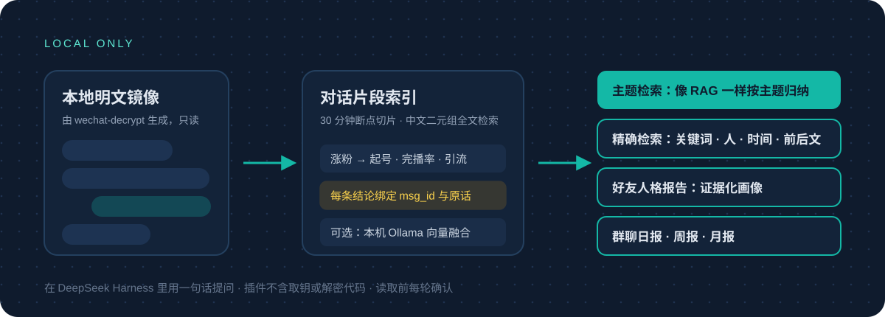
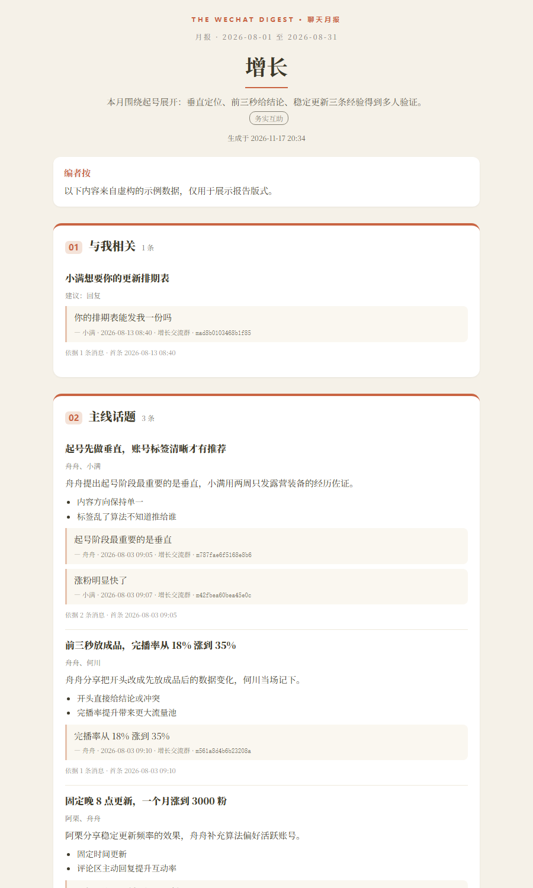
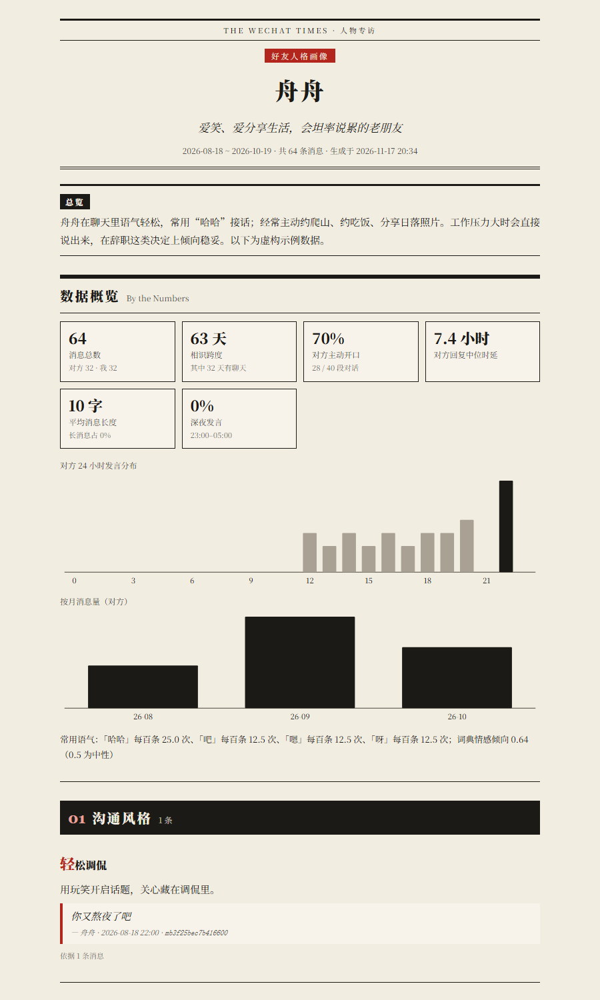
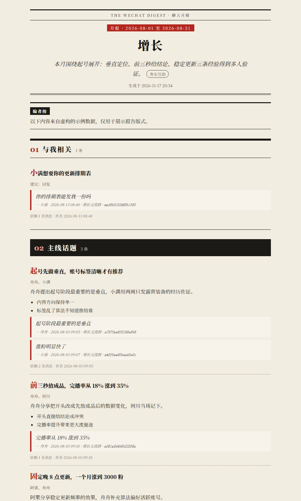
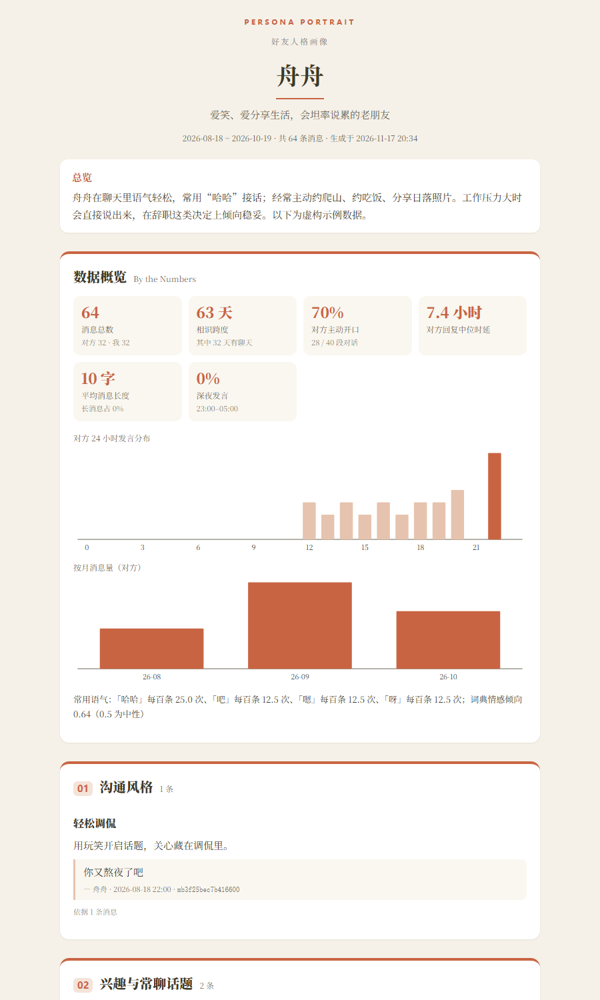

<div align="center">


<br>

[](package.json)
[](#安装与接入)
[](#安装与接入)
[](LICENSE)
<br>
[](#测试与开发)
[](#数据与隐私)
[](#数据与隐私)

**在 DeepSeek Harness 里，用一句话翻你自己的微信聊天记录。**<br>
<sub>按主题归纳 · 原话可查 · 结论带出处</sub>

<br>



</div>

---

## 项目介绍

dsh-wechat-one 是一个 DeepSeek Harness（DSH）插件。它读取本机微信 4.x 聊天记录的明文镜像，建一份只存在你电脑上的检索索引，然后让 DSH 里的助手替你做四件事：按主题找聊过的内容、按关键词查原文、给好友写一份有证据的人格报告、给群聊出日报。

明文镜像由外部工具 [WeinanHu/wechat-decrypt](https://github.com/WeinanHu/wechat-decrypt) 生成，插件可以一键调用它，但**插件仓库本身不含任何取钥或解密代码**。

## 为什么做

微信里积累了大量有用的讨论，可微信自带的搜索只能按字面匹配，搜“涨粉技巧”找不到“起号先做垂直”“前三秒放成品”这些真正有用的话。直接把聊天记录丢给大模型，又会遇到编数字、引文对不上原话、把别人的话安到你头上这些问题。

dsh-wechat-one 的做法是把工作拆开：

- **程序负责事实**：解析消息、切对话片段、建索引、算统计、校验证据。
- **助手负责理解**：把主题扩展成检索词、阅读召回的片段、写出归纳和判断。
- **插件负责把关**：每条结论必须绑定真实的消息 ID，引文必须和原文逐字一致，对不上就不出报告。

## 四种能力

<table>
<tr>
<td width="72" align="center"></td>
<td><b>主题检索</b>　像 RAG 一样工作<br>问“群里聊过哪些涨粉技巧”，助手先把主题扩展成一组检索词（起号、完播率、引流……），插件在所有会话里召回相关的对话片段，助手再归纳成带出处的要点清单。</td>
</tr>
<tr>
<td align="center"></td>
<td><b>精确检索</b>　关键词 · 发言人 · 日期 · 会话<br>两个字的中文词就能命中，结果按时间倒序分页；任意一条都能展开前后文，核对原意。</td>
</tr>
<tr>
<td align="center"></td>
<td><b>好友人格报告</b>　证据化画像<br>本地先算统计（活跃时段、谁先开口、回复时延、口头禅、情绪倾向），再分层抽样聊天素材；助手写出沟通风格、兴趣、情绪表达、互动模式，每条都附逐字原话。</td>
</tr>
<tr>
<td align="center"></td>
<td><b>群聊日报 · 周报 · 月报</b>　可以定时自动出<br>按“与我相关 / 主线话题 / 观点与分歧 / 值得跟进 / 精选链接”成稿；配合 DSH 定时任务每天自动出，错过的最多补 3 期。</td>
</tr>
</table>

## 报告预览

<div align="center">

| 群聊月报 · claude 主题 | 好友人格报告 · newspaper 主题 |
| :---: | :---: |
|  |  |
| **群聊月报 · newspaper 主题** | **好友人格报告 · claude 主题** |
|  |  |

</div>

> 预览图由 `python -X utf8 tools/gen_previews.py` 用测试里的虚构会话生成，不含任何真实聊天内容。报告都是不依赖外部资源的单文件 HTML，同时输出一份 Markdown。

## 能力详解

<details>
<summary><b>主题检索是怎么召回的</b></summary>

1. 消息按会话和 30 分钟的间隔切成对话片段，正文预先切成中文二元组，存进 SQLite FTS5 全文索引。所以“涨粉”这样的两字词也能命中。
2. 助手把你的主题原词扩展成 5 到 20 个检索词：同义词、口语、黑话、英文缩写。
3. 每个词分别召回片段，按排名融合打分，主题原词权重是扩展词的 2 倍。
4. 去重后，同一个会话每页最多出 3 段，避免一个话痨群刷满结果。
5. 片段原文返回给助手归纳，每条要点注明发言人、会话、日期和 msg_id。

本机装了 [Ollama](https://ollama.com) 的话，可以打开向量检索（默认模型 `bge-m3`），与全文检索的结果融合排序。向量服务只允许本机地址，聊天内容不会发到别的机器。

</details>

<details>
<summary><b>报告的生成和校验</b></summary>

人格报告和日报走同一条流水线：

1. `prepare`：本地取数、算统计、抽样素材，每条消息带唯一 msg_id，同时返回语义稿的格式要求。素材太大时分块，用 `summary_material` 逐块读取。
2. 助手按格式写语义稿。
3. `render`：插件逐条校验。msg_id 必须来自本次素材，引文必须与原文逐字一致；日报还会检查会话归属、链接和日期是否在报告范围内。通过后渲染出 Markdown 和单文件 HTML。
4. 校验不过时返回逐条错误，助手照着改一轮；日报仍不通过时可以只出统计版。

格式校验通过不等于观点已被核实，报告里会注明这一点。人格报告只反映这些聊天里的表达印象，不是心理测评。

</details>

<details>
<summary><b>接入与刷新</b></summary>

- 已经装过 wechat-decrypt（例如 [wechat-summary](https://github.com/Andrew-liu/wechat-summary) 配置过）的话，插件会直接复用，不重复安装。
- 刷新时只重新索引有变化的消息分片。数据没变时再刷新，几乎瞬间完成。
- 已经有现成的解密镜像，在插件配置里填 `sourcePath` 就能用，完全不碰解密工具。

</details>

<details>
<summary><b>定时日报</b></summary>

对助手说“每天早上 9 点给常看群出日报”，它会用 DSH 自带的 `schedule_create` 建一个每日任务。到点后：

1. `wechat_one_summary_pending` 查出还有哪几期没出（不读聊天正文）。
2. 刷新数据，逐期生成报告。
3. 出过的期记在台账里，不会重复出。

DSH 需要保持运行。DSH 重启后只补最近一次错过的触发，漏掉的期由台账补齐，最多补 3 期。

</details>

<details>
<summary><b>可靠性设计</b></summary>

- 每次工具调用都在独立子进程里运行，有超时、输出上限，可以取消；引擎崩溃不影响 DSH。
- 新索引先写到 `index.next.sqlite`，校验通过后原子替换；失败时保留上一版。
- 单写者锁：刷新进行中再次刷新会返回 `BUSY`，读请求不受影响。
- 索引损坏或结构版本变化会被检测出来，并提示重建。
- 5 个组件互相隔离，一个加载失败不影响其他，`wechat_one_status` 会报告每个组件的状态。

</details>

## 安装与接入

**运行环境**：Windows 10/11，电脑微信 4.x（已登录）；DSH 0.2.2 系列（已在 `0.2.2-rc.1` 验证），Node.js 22+；Python 3.10+，需带 SQLite FTS5。Python 3.14 自带 zstd 解压，更早的版本需要 `pip install zstandard`。

### 安装插件

```sh
dsh plugin --profile web add github:Andrew-liu/dsh-wechat-one
# 或者用本地目录
dsh plugin --profile web add file:/path/to/dsh-wechat-one
```

装好后**完整重启 DSH**。插件会往 profile 里加入 5 个组件：`core`、`setup`、`read`、`persona`、`summary`，可以在插件管理里分别启停。

### 首次接入

在 DSH 里说“接入微信聊天记录”，助手会按 `wechat_one_status` 给出的下一步一步步带你完成：

1. **安装解密工具**：找到已有的 wechat-decrypt 就复用；没有就在你同意后，把固定版本克隆到插件的私有目录。
2. **获取密钥**：会关闭微信，看到提示后从桌面重新打开并登录。
3. **解密并建索引**：首次需要几分钟。

以后想看最新记录，说“刷新微信记录”就行。

## 可以这样问

> 我加的群里聊过哪些涨粉技巧？按技巧归纳，附原话和出处
>
> 上个月和舟舟聊到辞职的那段，给我原文和前后文
>
> 给舟舟生成一份人格报告，用 claude 主题
>
> 出一份常看群昨天的日报 / 出增长交流群上周的周报
>
> 每天早上 9 点给常看群出日报

## 工具一览

所有工具都以 `wechat_one_` 开头。读取类工具每轮用户提问只确认一次，写入类每次单独确认。

| 组件 | 工具 | 作用 | 审批 |
| --- | --- | --- | --- |
| setup | `status` | 接入与健康状态、建议的下一步 | 无需 |
| setup | `setup` | 一键接入：安装工具、取密钥、解密 | 每次 |
| setup | `refresh` | 重新解密并增量更新索引 | 每次 |
| read | `contacts` | 按名称找会话，拿到 `conversation_id` | 每轮 |
| read | `search` | 关键词精确检索，可按会话、发言人、日期过滤 | 每轮 |
| read | `topic_search` | 主题检索（RAG），召回相关对话片段 | 每轮 |
| read | `context` | 查看某条消息的前后文 | 每轮 |
| persona | `persona_prepare` | 准备人格报告的统计和素材 | 每轮 |
| persona | `persona_render` | 校验语义稿并生成报告 | 每次 |
| summary | `summary_pending` | 查询还有哪些期没出 | 每轮 |
| summary | `summary_prepare` | 准备日报、周报、月报素材 | 每轮 |
| summary | `summary_material` | 分块读取大素材 | 每轮 |
| summary | `summary_render` | 校验语义稿并生成报告 | 每次 |

## 配置

| 键 | 默认 | 说明 |
| --- | --- | --- |
| `confirmReads` | `true` | 读取聊天正文前每轮确认一次 |
| `stateDirectory` | `~/.dsh-wechat-one` | 索引、报告、日志所在的私有目录 |
| `sourcePath` / `sourceType` | 自动 | 解密镜像目录或 JSON 文件 |
| `decryptToolDir` / `decryptToolRef` / `allowDecryptInstall` | 自动 / 内置版本 / `true` | wechat-decrypt 接入 |
| `allowedConversations` | `[]` | 只允许查询这些会话（显示名或微信 ID），留空不限制 |
| `meNames` | `[]` | 我在群里的昵称，用于日报“与我相关”；留空读 wechat-summary 的 `me.names` |
| `groupSets` | `{}` | 日报群集合（集合名 → 群名或会话 ID）；留空读 wechat-summary 的 `group_sets` |
| `embeddingProvider` | `none` | 设为 `ollama` 开启本地向量混合检索，只允许本机地址 |
| `maxItems` / `maxContentChars` | `30` / `500` | 返回条数与单条长度上限 |

报告保存在 `~/.dsh-wechat-one/reports/` 下，日报按 `summary/<群或集合名>/<周期>-<日期>/` 归档。

## 测试与开发

```sh
npm test               # JS 23 个：组件契约、审批、子进程桥、真实引擎集成
npm run test:python    # Python 56 个：索引、检索、人格报告、日报、接入、架构依赖方向
npm run privacy        # 发布前检查：不含解密代码、密钥或数据
npm run manifest       # 改了 Python action 后重新生成 engine/manifest.json
python -X utf8 tools/gen_previews.py   # 重新生成 README 预览图
```

测试全部使用 `tests/python/fixtures.py` 里的虚构会话，不需要微信，也不会读你本机的配置。

## 技术栈

| 层 | 选型 |
| --- | --- |
| 插件层 | Cordis 组件（JS，ESM，无构建步骤），`defineTool` 注册工具，按风险分级审批 |
| 桥接 | 子进程 JSON 协议，超时、输出上限、取消、环境变量白名单 |
| 引擎 | Python 3.10+ 标准库 |
| 索引 | SQLite FTS5，中文二元组切分；可选 Ollama 向量，RRF 融合 |
| 渲染 | 自研模板，主题 = 公共骨架 + 各自 `style.css`，内联 SVG 图表 |
| 数据来源 | [WeinanHu/wechat-decrypt](https://github.com/WeinanHu/wechat-decrypt) 的明文镜像，只读打开 |
| 测试 | `node --test` + `unittest`，合成样例数据 |

## 数据与隐私

- 聊天数据只在本机处理。插件不收集遥测，索引和报告只保存在本地私有目录。
- 插件不含解密、注入、Hook 或取钥代码，这部分由你自行安装的外部工具完成。
- 工具返回给模型的字段有白名单；读取聊天正文前默认每轮确认，可以用 `allowedConversations` 限定只查哪些会话。
- 你在 DSH 里用的是云端模型的话，助手读到的聊天片段会发给该模型服务商，这一点和你在 DSH 里粘贴聊天记录是一样的。
- 只处理你本人有权访问的数据。人格报告涉及他人信息，仅供个人回顾，请勿公开传播。

完整说明见 [PRIVACY.md](PRIVACY.md)。本项目与腾讯、微信、DeepSeek 均无关。

## 项目结构

```text
dsh-wechat-one/
├── components/        # Cordis 组件：core、setup、read、persona、summary
├── manifests/         # 每个组件的工具声明、参数与返回字段白名单
├── lib/               # JS 公共层：子进程桥、审批、注册、错误、配置
├── engine/wechat_one/
│   ├── core/          # 分发、配置、状态、锁、日志、审计
│   ├── data/          # 数据源、消息解析、片段切分与索引
│   ├── shared/        # 检索、证据校验、统计、时间窗、渲染与主题
│   ├── features/      # setup、read、persona、summary 各自的 action
│   └── integrations/  # wechat-decrypt 接入、本地向量服务
├── tests/             # JS 与 Python 测试、DSH 宿主探针
├── tools/             # 隐私检查、manifest 生成、预览图生成
└── docs/images/       # README 用到的图片
```

## 扩展新功能

后续计划中的聊天总结、高情商沟通辅助、自动发消息都按同一套方式接入，不需要改 `core`、`lib` 或 `shared`：

1. 在 `engine/wechat_one/features/` 新建文件，用 `@action` 注册，取数只走 `shared/retrieval`。
2. 在 `manifests/` 声明工具、参数、返回字段白名单和风险等级。
3. 在 `components/` 用 `featureComponent(id)` 装配，在 `cordis.patch.yml` 加一行。
4. 补上组件契约测试，跑一遍 `npm run test:all`。

欢迎通过 Issues 反馈问题或提建议。

## 许可

[MIT](LICENSE)。第三方代码归属见 [THIRD_PARTY_NOTICES.md](THIRD_PARTY_NOTICES.md)。
